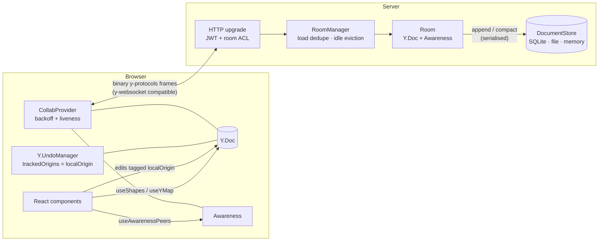

# canvas-collab

A real-time collaborative whiteboard: sticky notes, rectangles, ellipses and connectors on an
infinite canvas, with live cursors, selection presence, offline-tolerant editing and per-user
undo. It is built on the [Yjs](https://github.com/yjs/yjs) CRDT, with a sync server written
directly on `ws` and React on the client.

The point of the project is the plumbing, not the feature count. It shows how to build a
collaborative editor that holds up in production: a wire protocol that stays correct when
connections drop, persistence that does not grow without bound, authentication at the edge, and
a test suite that runs real clients against a real server.

## Demo

```bash
npm install
npm run dev            # sync server on :1234, web app on :5173
```

Open <http://127.0.0.1:5173>. You are sent to a fresh `?room=` URL. Copy the invite link into a
second tab or browser (each tab is its own participant) and then:

- add notes and shapes from the toolbar (`S`, `R`, `O`), or double-click the canvas to drop a
  note and start typing;
- drag, resize (single selection), shift-click or marquee to multi-select, then `Ctrl+D` to
  duplicate, arrow keys to nudge and `Delete` to remove;
- draw a connector (`C`) from one shape to another; it follows both shapes when they move;
- see the other tab's cursor, avatar and selection outlines in its colour;
- `Ctrl+Z` / `Ctrl+Shift+Z` undo only **your** changes, never a collaborator's;
- stop the server, keep editing in both tabs, then restart it. Both tabs reconnect on their own
  and merge.

Pan with the scroll wheel or Space + drag. Zoom with `Ctrl` + scroll, `+` / `-`, or `0` to reset.

## Architecture

```
apps/
  server/   Node sync server: ws + y-protocols, SQLite persistence, JWT room auth, pino
  web/      React 19 + Vite client: SVG canvas, Yjs hooks, presence UI
packages/
  shared/   Board schema (zod), Y.Doc helpers, wire protocol, CollabProvider (browser + Node)
e2e/        Playwright: two browser contexts editing one board
```

`packages/shared` is an _internal package_: it ships TypeScript source, which Vite and Vitest
consume directly and which `tsup` bundles into the server build. There is no separate build step
for it and no stale `dist/` to go out of date, and editors jump to the real source.

### Sync flow

```mermaid
sequenceDiagram
    autonumber
    participant A as Client A (CollabProvider)
    participant S as Sync server (Room)
    participant DB as DocumentStore (SQLite)
    participant B as Client B

    Note over A,S: Upgrade: GET /rooms/:id?token=JWT, verified before the WebSocket exists
    A->>S: SyncStep1(stateVector A)
    S->>A: SyncStep2(diff A is missing)
    S->>A: SyncStep1(stateVector S)
    A->>S: SyncStep2(diff S is missing, including offline edits)
    Note over A,S: replicas now equal; provider emits synced=true

    A->>S: Update(Δ) after a local edit
    S->>DB: append(Δ) through the room's serial queue
    S->>B: Update(Δ) broadcast to all except origin
    A->>S: Awareness(cursor, selection)
    S->>A: Awareness echo (keeps A's liveness timer fed)
    S->>B: Awareness

    Note over S,DB: every N updates / T seconds / on idle unload
    S->>DB: compact(encodeStateAsUpdate(doc)) → snapshot, truncate log
```



### Key design decisions

**Document model.** `doc.getMap('shapes')` maps shape ids to _nested_ `Y.Map`s, one field per
key. Two people editing different fields of the same shape (one drags while the other types)
merge cleanly. Concurrent writes to the same field resolve last-writer-wins, which is the
behaviour you want for geometry. Every read is validated with zod (`readShape`), so a malformed
shape from a buggy or hostile peer is skipped rather than crashing every client that renders it.
All writes go through helpers in `packages/shared/src/doc.ts` that are transactional, validated
before they touch the doc, and write only fields whose value changed.

**Per-user undo.** Local edits are tagged with a session-specific `localOrigin` object, and the
`Y.UndoManager` tracks only that origin. Remote updates arrive with the provider as origin, so
undo never reverts a collaborator's work. A drag is grouped into one undo step with
`stopCapturing()` at gesture boundaries, and a cascading delete (a shape plus its connectors)
is one transaction, so a single undo restores all of it.

**Wire protocol.** Frames are byte-compatible with `y-websocket` (sync = 0, awareness = 1). The
server is hand-written, but any stock Yjs client can connect to it. The server sends its own
SyncStep1 when a client connects, which is how edits a client made while offline get pulled in.

**React bindings.** `useYMap(ymap, select)` adapts any Y type to `useSyncExternalStore`, so React
gets no tearing in concurrent rendering and the snapshot is recomputed lazily, at most once per
change batch. `useShapes` keeps object identity for unchanged shapes, so the memoised
`ShapeView`s re-render only when their own shape changes. Components take a `BoardSession`
(doc, awareness, undo manager) and never a socket, so the whole board renders in tests against a
bare `Y.Doc`.

## Why CRDTs rather than OT

Operational transformation needs a central server to put operations in order and transform
concurrent ones against each other. That makes the server stateful in a way that is hard to
scale, and it makes offline editing awkward because a long-diverged client has to be rebased
through every intermediate operation. Transformation functions for rich structures such as
trees, maps and moves are also notoriously hard to get right.

A CRDT moves convergence into the data type. Any two replicas that have seen the same set of
updates are identical, whatever order the updates arrived in. In practice:

- **Offline is not a special case.** A client reconnects, exchanges state vectors and sends the
  diff. The server has no rebase logic.
- **The server is a relay plus durable storage, not an arbiter.** It never transforms
  anything, which matters for the scaling story below.
- **Updates are idempotent and commutative.** Persistence can be at-least-once, and recovering
  from a crash means replaying the log.

The costs are real. CRDT metadata (item ids, tombstones) grows with edit history, and last-writer-wins
on a field is not intent-preserving merge. The persistence and trade-off sections below cover how
each is handled. For a whiteboard, where most edits are independent property writes, the trade
favours CRDTs heavily.

## Persistence and compaction

`DocumentStore` is a small interface (`load`, `append`, `compact`, `close`) with three
implementations: **SQLite** (`better-sqlite3`, WAL mode, the default), a **file store**
(length-prefixed append log plus a snapshot file), and **memory** (tests and throwaway
deployments).

- **Write path:** each incremental update is appended. That is cheap and sequential, and the
  only thing on the hot path.
- **Read path:** load the snapshot, then replay the log in one transaction.
- **Compaction** runs when a room passes `COMPACTION_UPDATE_THRESHOLD` appended updates, on a
  timer (`COMPACTION_INTERVAL_MS`) for rooms with pending updates, when an idle room is unloaded,
  and on graceful shutdown. The room encodes its full in-memory state _inside its serial
  persistence queue_, so every earlier append has already landed and the snapshot is a superset
  of the log it replaces. The store then swaps the snapshot and truncates the log atomically: a
  single `BEGIN IMMEDIATE` transaction in SQLite, write-temp-then-rename in the file store.
  Encoding from a live `Y.Doc` also garbage-collects the content of deleted items, which is where
  most of the space goes on a busy board. Compacting from the in-memory doc also self-heals: if
  an append ever fails, the next snapshot still contains the update.
- **Crash safety follows from idempotence.** A torn trailing record in the file log is ignored.
  A crash between snapshot swap and log truncation means some updates are replayed on top of a
  snapshot that already contains them, and Yjs treats that as a no-op. Both cases have tests.

`PERSISTENCE=auto` tries SQLite and falls back to the file store if the native binding cannot
load, for example when there is no prebuilt binary for the platform or Node ABI and no
toolchain to compile one. On the development machine (Windows, Node 24) the prebuilt
`better-sqlite3` binary loaded and the SQLite suite ran. The fallback exists so the server still
boots everywhere.

## Server operational concerns

- **Auth:** HS256 JWTs (`jose`) carry `sub`, `name`, `room` (or `*`) and `role`
  (`editor` | `viewer`). They are verified during the HTTP upgrade, so unauthenticated clients
  are rejected with a plain `401`/`403` before any WebSocket or room state exists. Viewers can
  sync and show presence, but their document writes are dropped. `POST /api/token` issues demo
  tokens and is disabled by default in production, where tokens should come from your identity
  provider. Tokens travel in the query string because browsers cannot set headers on a
  WebSocket. Keep them short-lived and make sure proxies do not log query strings.
- **Heartbeat:** the server pings every `HEARTBEAT_INTERVAL_MS` and terminates sockets that
  missed the previous pong. The client has a liveness timer of its own: the server echoes
  awareness renewals (about every 15s), so 30s of silence means the socket is half-open and the
  client reconnects.
- **Backpressure:** if a client's send buffer passes `MAX_BUFFERED_BYTES`, it is disconnected
  with `1013 Try Again Later`. Dropping CRDT updates would corrupt the client's replica, and an
  unbounded buffer would let one slow client exhaust server memory. On reconnect the client
  gets a single state-vector diff, which is smaller than the backlog would have been. Inbound
  frames are capped at `MAX_MESSAGE_BYTES`.
- **Reconnect:** exponential backoff with full jitter, so a server restart does not cause a
  thundering herd. Tokens are re-fetched before expiry on each attempt.
- **Lifecycle:** room loads are de-duplicated (two clients racing into a cold room share one
  load), and messages that arrive while a room is loading are buffered. Empty rooms are compacted
  and unloaded after `ROOM_IDLE_TTL_MS`. On `SIGINT`/`SIGTERM` the server stops accepting
  upgrades, closes clients with `1001`, compacts every room, closes the store and exits. A hard
  deadline (`SHUTDOWN_TIMEOUT_MS`) applies if any of that hangs.
- **Observability:** structured pino logs with room and connection context, pretty-printed in
  development and JSON elsewhere, with token redaction. `GET /healthz` reports status, uptime,
  room and connection counts and the active persistence backend, and returns `503` while
  draining.

## Scaling notes

Today a room lives on exactly one process, which is the right shape for a single node. Scaling
out takes two steps, in this order:

1. **Sticky routing by room.** Put the sync servers behind a load balancer that hashes on the
   room id from the `/rooms/:id` path (consistent hashing, or a room→node lease in Redis). Every
   client of a room lands on the same process, so the in-memory `Room` stays authoritative and no
   cross-node traffic is needed. This alone goes a long way because rooms are independent.
2. **Pub/sub fan-out for hot or migrating rooms.** When one room must span nodes (very large
   audiences, rolling deploys without disconnects), each node holding a replica of the room
   publishes the updates it receives to a Redis channel per room (`room:{id}`) and applies what
   other nodes publish. Because CRDT updates commute and are idempotent, ordering and duplicate
   delivery across nodes do not matter, so plain Redis pub/sub is enough and no consensus layer
   is needed. Awareness goes over the same channel. Persistence moves to one writer per room
   (the lease holder) or to a shared store with idempotent appends.

Further out: move snapshots to object storage with the log in Postgres or Redis Streams, cap
per-room fan-out with read-only "viewer" replicas, and add per-connection rate limits.

## Trade-offs and known limitations

- **Sticky text is last-writer-wins.** Note text is a plain string field, so two people typing
  in the _same_ note at the same moment overwrite each other. Switching to `Y.Text` plus a
  text-binding editor is the fix; it was left out to keep the editor simple.
- **No client-side persistence.** Offline edits survive a dropped connection but not a closed
  tab. Adding `y-indexeddb` would close that gap.
- **Rendering is SVG with full-list diffing.** That is fine for hundreds of shapes. Thousands
  would need viewport culling or a canvas/WebGL renderer, plus incremental snapshot updates from
  `event.keysChanged` instead of re-reading the map.
- **History is not retained.** Compaction garbage-collects deleted content, which bounds
  storage but rules out "view board as of yesterday". Keeping periodic snapshots with `gc: false`
  would enable time travel at the cost of disk space.
- **Demo identity.** Users are anonymous and per tab; `/api/token` will sign anything it is
  asked to. It is a stand-in for a real IdP.
- **Freehand drawing** is not implemented. The shape schema is a discriminated union, so adding
  it is a new variant plus a renderer.

## Local setup

Requirements: Node ≥ 22.12 (developed on Node 24) and npm ≥ 10.

```bash
npm install
cp .env.example apps/server/.env      # optional; dev defaults work without it
npm run dev
```

npm 11 blocks dependency install scripts by default. `package.json` allow-lists the two that need
them (`better-sqlite3` for its native binary, `esbuild`). If SQLite still fails to load, the
server logs a warning and uses the file store.

| Script                 | What it does                                                     |
| ---------------------- | ---------------------------------------------------------------- |
| `npm run dev`          | Server (`tsx watch`) and Vite dev server, side by side           |
| `npm run lint`         | ESLint flat config (typescript-eslint strict + react-hooks)      |
| `npm run format:check` | Prettier                                                         |
| `npm run typecheck`    | `tsc --noEmit` for every workspace plus the E2E sources          |
| `npm test`             | Vitest: shared, server (real sockets, real SQLite) and web (RTL) |
| `npm run build`        | Server bundle (`tsup`) and web bundle (`vite build`)             |
| `npm start`            | Run the built server (`apps/server/dist`)                        |
| `npm run test:e2e`     | Playwright; boots both servers itself                            |

Before the first E2E run, install a browser with `npx playwright install chromium`.

### Testing strategy

- **shared:** schema validation edge cases, doc helpers (cascading deletes, duplication
  rewiring, no-op writes, concurrent-merge semantics) and per-origin undo. Also covers the
  protocol encoders and handlers, read-only enforcement and backoff maths.
- **server:** JWT signing and verification (expiry, tampering, `alg: none`, wrong secret,
  malformed claims), config validation, and every store implementation behind one shared
  contract suite (compaction, ordering, isolation, durability across reopen, torn writes, crash
  between snapshot swap and truncation). Integration tests start the real server on an ephemeral
  port and connect **real `CollabProvider` clients** over WebSockets. They cover convergence
  under concurrent edits, offline edits merging on reconnect, presence propagation and cleanup,
  viewer write rejection, threshold compaction with room eviction and reload, persistence on
  shutdown, and upgrade rejection codes.
- **web:** React Testing Library against a real `Y.Doc` with no network. Covers creating and
  editing notes, remote shapes appearing, drag-to-move, marquee selection, keyboard delete plus
  undo that leaves remote work alone, shortcuts, remote cursors and avatars from awareness, plus
  pure geometry tests.
- **e2e:** two isolated browser contexts on one room see each other's presence, notes, moves,
  cursors and deletes; a late joiner receives the existing board.

## License

[MIT](./LICENSE) © jwin345-spec
